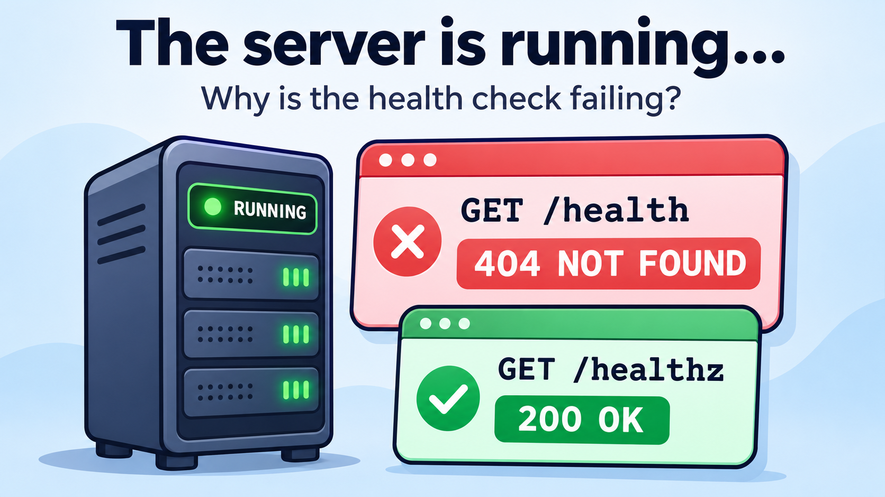
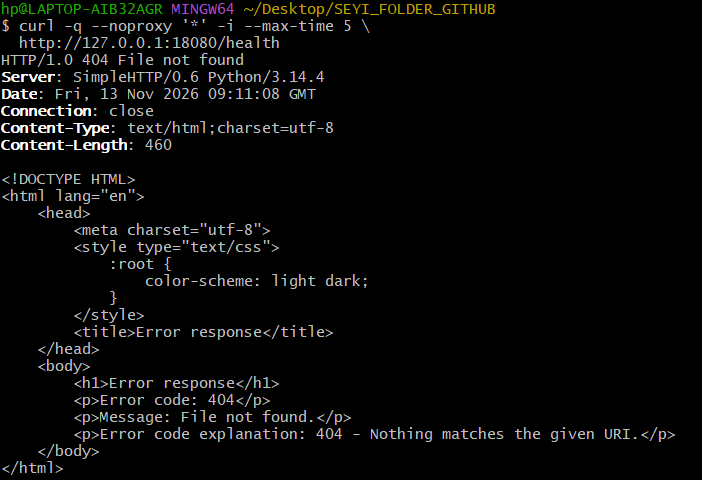
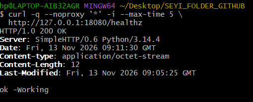
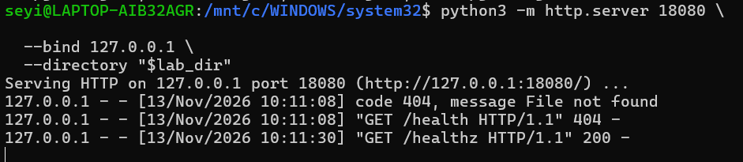
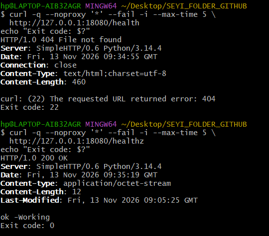
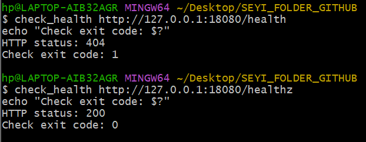

# HTTP Health Check Troubleshooting Lab

**The server is running - why is the health check failing?**



## Overview

I reproduced a health-check failure caused by requesting the wrong endpoint on a running web server.

The server provided `/healthz`, but the failing request targeted `/health`. Comparing the responses and server logs showed that the problem was the requested path.

I then used curl exit codes and a Bash function to turn the result into a check that automation could act on. The tested function is included in this repository as a reusable script.

This was a deliberately configured local troubleshooting exercise.

### Results

| Request | HTTP response | Exact-200 function exit code |
|---|---|---|
| `/health` | `404 File not found` | `1` — failed |
| `/healthz` | `200 OK` | `0` — passed |

The server remained running during both requests.

## Why this matters

A health check evaluates a specific condition. For this exercise, that condition was:

> The request must complete successfully and return exactly HTTP 200 within the allowed time.

A running process does not guarantee that the requested endpoint exists. Likewise, a successful response from one endpoint does not prove that every application feature works.

This distinction matters when a deployment process or monitoring system uses a health check to decide whether a service is ready.

## Tools and environment

| Tool | Purpose |
|---|---|
| Windows Subsystem for Linux (WSL) | Ran the Python server and managed the repository |
| Git Bash | Sent the original curl requests and tested the function |
| Python 3 | Served the demonstration endpoint |
| curl | Inspected responses and provided HTTP status information |
| Bash | Implemented the reusable check |
| Vim | Edited the lab file and script |
| Git and GitHub | Tracked and published the project |

The original requests from Git Bash reached the server running in WSL. To reproduce the exercise, two terminals in the same WSL distribution can also be used.

### Repository contents

| Path | Contents |
|---|---|
| [`scripts/health-check.sh`](scripts/health-check.sh) | Reusable Bash health-check script |
| [`screenshots/`](screenshots/) | Screenshots from the completed lab |
| [`screenshots/illustration.png`](screenshots/illustration.png) | Cover illustration |
| [`.gitignore`](.gitignore) | Exclusions for temporary editor files and Windows thumbnail cache |
| [`README.md`](README.md) | Setup, investigation, results, and lessons |

The demonstration endpoint is created in a temporary directory during the lab.

## Reproduce the lab

### 1. Get the repository

Clone the repository, or open an existing local copy:

```bash
git clone https://github.com/seyi35/http-health-check-lab.git
cd http-health-check-lab
```

You will need Bash, curl, Vim, and Python 3.7 or later for the commands below.

### 2. Create the endpoint in Terminal 1

In WSL:

```bash
lab_dir=$(mktemp -d -t seyi-healthcheck-XXXXXX)
vim "$lab_dir/healthz"
```

Enter:

```text
ok -Working
```

Save and close Vim with **Esc**, `:wq`, and **Enter**.

This static file stands in for a health endpoint. Its contents do not reflect the state of a database or other application dependencies.

### 3. Start the server

In that same terminal:

```bash
python3 -m http.server 18080 \
  --bind 127.0.0.1 \
  --directory "$lab_dir"
```

The server listens on the local loopback address and serves files from the lab directory.

Leave this terminal running. If port `18080` is already occupied, choose an unused port and substitute it throughout the exercise.

### 4. Request the missing endpoint in Terminal 2

```bash
curl -q --noproxy '*' -i --max-time 5 \
  http://127.0.0.1:18080/health
```

My response began:

```text
HTTP/1.0 404 File not found
```



The server answered, but the requested file did not exist.

### 5. Request the intended endpoint

Change only the path:

```bash
curl -q --noproxy '*' -i --max-time 5 \
  http://127.0.0.1:18080/healthz
```

Relevant parts of my response:

```text
HTTP/1.0 200 OK

ok -Working
```



The command options include response headers, limit the request to five seconds, skip curl's default configuration file, and bypass proxies for this local test.

## Investigation and diagnosis

The server logs recorded both requests:

```text
127.0.0.1 - - [13/Nov/2026 10:11:08] "GET /health HTTP/1.1" 404 -
127.0.0.1 - - [13/Nov/2026 10:11:30] "GET /healthz HTTP/1.1" 200 -
```



The evidence established that:

- Both requests reached the Python server.
- `/health` returned 404.
- `/healthz` returned 200 and the expected file contents.
- The server continued running throughout both requests.

**Root cause:** the failing check requested `/health`, while the demonstration endpoint was `/healthz`.

**Correction:** point the check at `/healthz` and retain the expected success condition.

Accepting 404 as healthy would hide the mismatch. The intended endpoint would still not have been checked successfully.

A 404 alone proves that an HTTP server answered. In this exercise, the matching logs and successful request to the created file established the specific cause.

## Exposing failure through exit codes

An HTTP status code and a shell exit code describe different things:

- The HTTP status describes the server's response.
- The exit code reports the command's outcome to the shell.

By default, curl does not treat an HTTP error response as a command failure. Adding `--fail` makes this 404 return exit code `22`.

I ran:

```bash
curl -q --noproxy '*' --fail -i --max-time 5 \
  http://127.0.0.1:18080/health
echo "Exit code: $?"

curl -q --noproxy '*' --fail -i --max-time 5 \
  http://127.0.0.1:18080/healthz
echo "Exit code: $?"
```

### Observed results

| Endpoint | HTTP status | curl exit code with `--fail` |
|---|---|---|
| `/health` | `404` | `22` |
| `/healthz` | `200` | `0` |



`$?` contains the previous command's exit code, so each `echo` must run immediately after its curl command.

The `--fail` option handles HTTP errors; it does not enforce an exact-200 success rule.

## Reusable health-check script

The script is available at [`scripts/health-check.sh`](scripts/health-check.sh).

It captures the HTTP status, checks whether curl completed successfully, and compares the returned status with `200`.

The connection timeout is two seconds, and the overall request timeout is five seconds.

### Usage

With the lab server still running, execute these commands from the repository root:

```bash
bash scripts/health-check.sh http://127.0.0.1:18080/health
echo "Check exit code: $?"

bash scripts/health-check.sh http://127.0.0.1:18080/healthz
echo "Check exit code: $?"
```

### Exit codes

| Code | Meaning |
|---|---|
| `0` | The request completed successfully and returned HTTP 200 |
| `1` | curl could not complete the request, or the response was not HTTP 200 |
| `2` | The caller supplied no URL, an empty argument, or more than one argument |

### Recorded function tests

Before packaging the script, I tested its `check_health` function directly in Git Bash.

The results were:

```text
HTTP status: 404
Check exit code: 1

HTTP status: 200
Check exit code: 0
```



The saved script uses this function and adds a check requiring one URL argument.

Its exit code can be used by an automated process to decide whether to continue or take a failure branch. This repository demonstrates the check itself; integration into a deployment pipeline is a possible next step.

## Setup challenges encountered

### Python command differences

My initial attempt to run `python3` in Git Bash returned:

```text
bash: python3: command not found
```

Python was available there under `python`. I chose to run the server in WSL using `python3`, while sending the initial requests from Git Bash.

The temporary directory variable and server command were kept in the same WSL terminal.

### GitHub authentication

The HTTPS push prompted for a username and password. I switched the repository's remote to SSH and pushed successfully:

```bash
git remote set-url origin git@github.com:seyi35/http-health-check-lab.git
git push -u origin main
```

These were setup issues, separate from the deliberately introduced endpoint mismatch.

## Limitations and design choices

- **Static endpoint:** returning a file does not test application dependencies or user workflows.
- **Status-only check:** the script discards the response body, so it does not verify the text `ok -Working`.
- **Exact-200 rule:** this is the success condition chosen for the lab. Other services may define a different valid response.
- **Local scope:** the results demonstrate requests to this local server, not reachability from a remote client.
- **Demonstration server:** Python's `http.server` is intended for simple testing and is not recommended for production hosting.

Using a temporary directory, binding to loopback, and bounding request duration kept the exercise small and reproducible.

### Possible improvements

For an application used in production, I would:

- Define what the health endpoint should prove and which dependencies it should check.
- Test from the environment that actually depends on the service.
- Record the requested endpoint, response status, and request duration.
- Make the deployment or monitoring process act explicitly on failed checks.

These are proposed improvements, not features implemented in this lab.

## Cleanup

Save any evidence you want to keep, then press **Ctrl+C** in the original server terminal.

In that same terminal:

```bash
rm -- "$lab_dir/healthz"
rmdir -- "$lab_dir"
unset lab_dir
```

This removes the temporary endpoint and its empty directory. The repository files and screenshots remain available.

## Key lessons

- Process state and health-check results answer different questions.
- Compare the requested path with the endpoint the application actually provides.
- Use server logs to connect a client-side result to the request the server handled.
- Keep HTTP response codes separate from shell exit codes.
- Verify the intended success condition instead of weakening it to make a failing check pass.

## References

- [Python documentation: http.server](https://docs.python.org/3/library/http.server.html)
- [curl documentation: command-line options](https://curl.se/docs/manpage.html)
